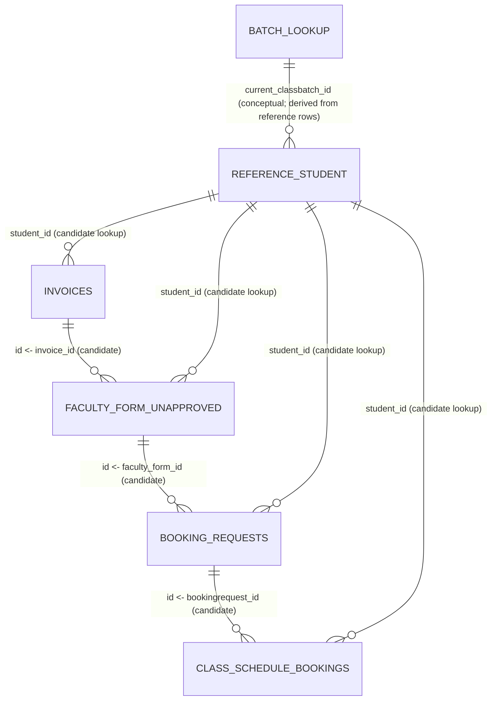

# Phase 1 Relationship Mapping

## Candidate links observed in the files

| From | To | Candidate columns | Evidence in supplied sample | Confidence / caveat |
|---|---|---|---|---|
| `invoices` → `faculty_form_unapproved` | `invoices.id` ← `faculty_form_unapproved.invoice_id` | Explicitly named invoice ID in form; 11 distinct form invoice IDs vs 13 invoice rows. 10 distinct form invoice IDs match invoice IDs; one form invoice ID (`INV-N`) has no match. The form contains a repeated invoice ID (one value occurs twice). | Strong candidate; unmatched and repeated values require exception review. Do not join on invoice link alone without policy. |
| invoice ↔ form | `student_id`, `user_id`, `class_id`, `educator_id`, invoice link | IDs align across many records and provide corroborating identity/context; student ID match rows can be multiple because forms repeat student STU-L. | Corroboration, not a substitute for the direct invoice ID. Similar labels do not establish identical semantics. |
| `faculty_form_unapproved` → `booking_requests` | `faculty_form_unapproved.id` ← `booking_requests.faculty_form_id` | All 4 booking request rows match a form ID. | Strong candidate direct link in this sample. Sample is partial (4 vs 12 rows). |
| `booking_requests` → `class_schedule_bookings` | `booking_requests.id` ← `class_schedule_bookings.bookingrequest_id` | Both schedule rows refer to request `REQ-A`; no other booking request has a schedule row in this sample. | Strong candidate direct link; absence of schedule rows for other requests cannot alone establish a fault. Multiple schedules per request are observed. |
| All operational files → reference student | `student_id`; corroborate with `user_id` | All 13 invoice rows and all 12 form rows match a reference student ID. Four booking requests and two schedule rows also match IDs for their referenced students. | Strong candidate for identity validation. Reference data is a snapshot; freshness and authority are unknown. |
| Operational batch → reference batch | operational `current_classbatch_id` or `classbatch_id` ← reference `current_classbatch_id` | Nine distinct form current batch IDs match reference; all three non-null booking batch IDs and schedule batch IDs match. | Candidate lookup, but do not infer selected/target batch semantics from “current” alone. |
| Operational class/educator → reference | `class_id`, `educator_id` | Values are present in each table and align in several records. | Useful corroboration; IDs may describe current versus requested/assigned state. Confirm semantics. |

## Key candidates and limits

- `invoices.id`, `faculty_form_unapproved.id`, `booking_requests.id`, `class_schedule_bookings.id`, and reference `student_id` are unique in these samples and are potential primary keys. `invoice_number` is also unique in the invoice sample. Sample uniqueness is not proof of a declared database constraint.
- `faculty_form_unapproved.invoice_id` is not unique (one repeated value) and one value does not match an invoice ID. It should not be assumed to be a unique foreign key.
- `booking_requests.faculty_form_id` and `class_schedule_bookings.bookingrequest_id` are unique within their respective samples, but the latter repeats across two schedule rows by design or schedule granularity. Do not assume one-to-one cardinality.
- The reference file contains one row per student in this extract. `current_classbatch_id` repeats because multiple students can share a batch, so it is not a batch dimension table key by itself.

## Uncertainties requiring confirmation

1. Is `invoices.id` the authoritative transaction key and is `invoice_id` expected to be one-to-one with a renewal form?
2. Why is a form invoice ID repeated and why does one form invoice ID have no matching invoice row? Could be source extract scope, data error, or duplicate submission; the CSV alone cannot tell.
3. Are form `approval_status` and booking `request_status` authoritative workflow states? The form file includes approved and pending rows; booking requests include completed, pending allocation, failed batch full, and awaiting parent selection.
4. Is `current_classbatch_id` a historical/original batch or the intended continuation target? How does it differ from booking `classbatch_id` and schedule `classbatch_id`?
5. Does the reference snapshot represent current active membership and capacity at a point in time? What is the capacity calculation rule and how are concurrent seat holds handled?
6. Are invoice amounts inclusive of all discounts, and what amount field is the payment verification source of truth? How should partial payments be represented?
7. Are null `deleted_at` values the normal active/not-deleted convention? Confirm lifecycle semantics.

## Simple ER diagram (candidate links only)

The diagram represents candidate relationships, not confirmed schema constraints. `BATCH_LOOKUP` is conceptual and derived from repeated batch attributes in the reference file; there is no dedicated batch table.
