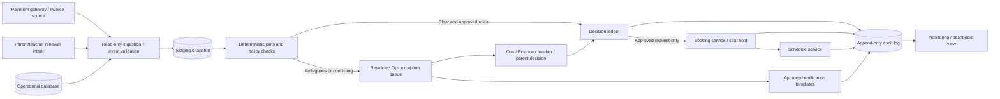

# Phase 3: AI and No-Code Architecture

**Design only.** No connector, workflow, approval action, dashboard, or notification has been built. Proposed tools are options for a small Ops team; integration capability, security and business rules must be confirmed before deployment.

## Recommended flow

`AUTO_APPROVED` applies to the renewal booking decision. A batch allocation and a schedule confirmation remain separate stages with their own evidence and audit events. A missing schedule row is not itself a failure.

## Components and responsibility

| Component | What it does | Method | Suggested tools | Why it fits |
|---|---|---|---|---|
| Source ingestion | Pulls invoice/payment events, renewal intent, forms, requests and schedule records into a dated staging view. Starts on gateway event and periodic reconciliation. | Deterministic integration; no AI | Existing database read-only views; payment API/webhook if supported; n8n for triggers; Python/Pandas for assessment-scale CSV batch | Preserves source systems and supports replays. Phase 2 depends on exact IDs and has no reliable as-of marker, so each import needs a timestamp/source watermark. |
| Payment verification | Confirms actual settlement status, amount, currency, reversals/refunds and gateway transaction reference. | Deterministic gateway evidence; Finance policy for ambiguous cases | Payment provider API/webhook (sample has `payment_gateway=Razorpay`; verify production provider and access), SQL/Python validation | A form or LLM is not proof of payment. Handle partial payments only under signed-off policy. |
| Identity and relationship matching | Joins invoice → form → booking → schedule and reference data using exact IDs; checks uniqueness and supporting student/user/class/educator values. | Deterministic SQL/Python | SQL constraints/views or Python/Pandas; database unique/idempotency keys | Phase 2 showed missing invoice references and a repeated invoice reference; fuzzy/student-only matching could mis-attach a payment. |
| Policy/decision layer | Applies versioned rules and returns the three outcomes plus reason code and evidence. | Deterministic rules; policy authored/approved by humans | Small Python module or SQL stored procedure; no LLM approval | Explicit, explainable and testable; safe for payment, duplicate and capacity gates. |
| Exception queue | Shows one task per unresolved case with record IDs, reason, owner, age, evidence and disposition. | Human judgment; deterministic queue routing | Restricted internal app or existing ticketing tool; n8n creates tasks; if starting with Sheets, use a permissioned workspace and masked fields only | Ops needs a clear owner and next action. Do not make an editable spreadsheet the payment or enrollment system of record. |
| Seat/capacity check | Reads current capacity and reserves a place atomically to avoid two requests taking the same last seat. | Deterministic service check; human/parent decision for alternatives | Existing booking service API with seat hold; otherwise Ops manually confirms | The Phase 2 reference snapshot is undated and batch BATCH-D appears full; it is not safe as a live allocation gate. |
| Booking/schedule write | Creates one request or missing schedule instances only after decision and seat/calendar checks; avoids duplicate side effects. | Deterministic transaction and idempotency | Existing booking API; if unavailable, controlled Ops action with confirmation | Request REQ-A has two valid class instances; generation needs calendar/session rules before automation. |
| Notifications | Sends approved templates for missing form/payment verification/duplicate/parent choice and confirms only after a seat and schedule are secured. | Template rules; human review for sensitive or ambiguous messages | WhatsApp Business API or email/CRM connector if already approved; Slack/Teams for internal queue alerts; n8n delivery orchestration | Clear stakeholder routing. Delivery, consent, retries and message IDs should be audited. No messages are sent in this phase. |
| Audit and monitoring | Stores every input version, rule version, outcome, reason, reviewer, side-effect ID and timestamp; shows queues and trends. | Deterministic logging/aggregation | PostgreSQL append-only decision/event tables; Metabase or existing BI for a later dashboard | Supports replay and reconciliation; dashboard is a future design component only, not built here. |
| AI assistance (optional) | Summarizes a flagged case in plain language or drafts a notification from an approved template. | LLM only for explanation/drafting; human approves | Enterprise-approved LLM through a restricted service; omit if privacy controls are unavailable | It can reduce writing effort, but cannot verify payment, change IDs, choose a batch, approve a student, or create a booking. |

## Small-team implementation pattern

1. **Start read-only:** use scheduled CSV exports or read-only database views and payment-provider reconciliation data. Add a source timestamp and snapshot ID. No writes to enrollment or scheduling tables in the first pilot.
2. **Run deterministic checks:** exact primary/foreign key joins, duplicate counts, status and amount checks, and reference validation. Every rule has a version and owner.
3. **Review before write:** all candidate decisions appear in a restricted queue. Finance owns payment interpretation; Operations resolves process/linkage; teacher supplies missing form information; parent confirms batch choice.
4. **Shadow mode:** compare proposed decisions with Ops decisions for an agreed pilot period. Measure false matches, missed exceptions and workload before enabling any approved happy-path write.
5. **Enable narrow writes only after sign-off:** feature flag, least-privilege service account, idempotency key, retry-safe transaction, audit event, rollback/compensation procedure and daily reconciliation. Begin with one known safe cohort and a kill switch.

## Where AI is and is not used

- **AI may:** summarize existing evidence for an Ops task, classify free-text remarks as a suggestion, or draft parent/teacher wording from approved templates.
- **AI may not:** decide whether funds settled, infer a missing invoice ID, choose which duplicate form wins, decide that a partial payment qualifies, infer same-batch consent, promise capacity, approve enrollment, or generate schedule rows.
- If an LLM is used, the source values and reason code remain deterministic; the generated explanation must be checked by a person and must not introduce new facts.

## Security and operational controls to confirm

Use least privilege, encrypted transport/storage, access-limited queues, masked contact fields where possible, retention limits, secret management, verified webhook signatures, retry/idempotency protections and an incident/rollback owner. Confirm privacy, payment-provider, messaging-consent and data-retention requirements with Bambinos.live before choosing vendors. These are design controls, not a claim about current infrastructure.
